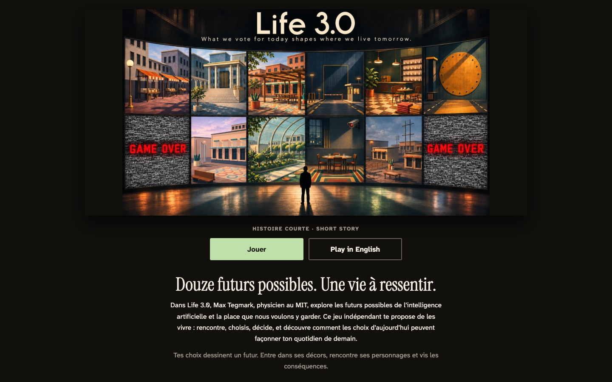
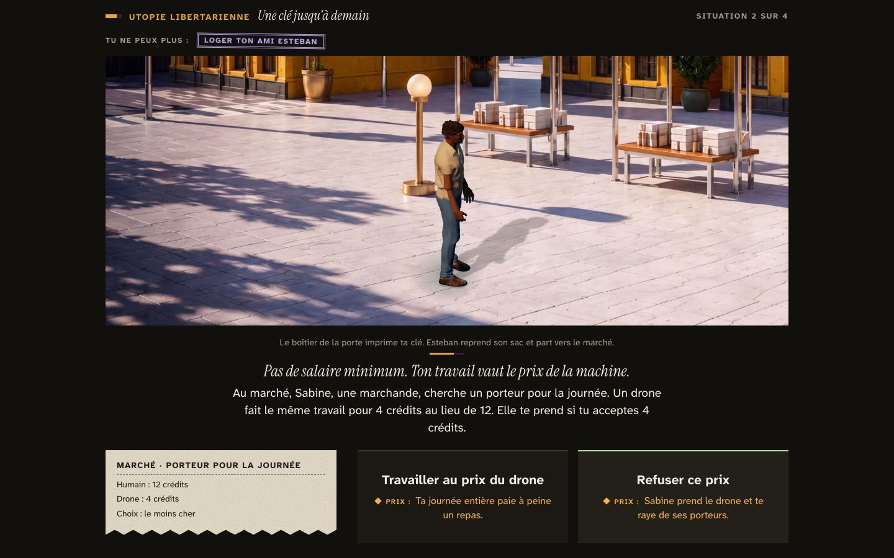

# Life 3.0

A short anticipation game inspired by Max Tegmark's *Life 3.0*: ten inhabited worlds and two extinctions. In each world you read a situation, choose between two options, and every option costs something.

Play it: https://life-3-0.pages.dev





## Stack

- TypeScript (strict), Vite, Three.js, Zod
- DOM and CSS interface, no UI framework
- Vitest for unit tests, Playwright for browser tests
- Exact dependency versions in `app/package.json` and `app/package-lock.json`

## Run it locally

```sh
cd app
npm ci
npm run dev
```

## Tests and build

```sh
cd app
npm run typecheck
npm test          # Vitest unit suite
npm run build     # production build in app/dist
npm run e2e       # Playwright browser tests (needs: npx playwright install chromium)
```

Some Playwright suites write evidence screenshots to a `production/` folder next to `app/`. That folder is not part of this repository and is created on demand.

## Licence

- Source code: [MIT](LICENSE).
- Images, illustrations, texts, stories, characters, and the name and branding of the game: all rights reserved, see [CONTENT-LICENSE.md](CONTENT-LICENSE.md).

## Credits

See [CREDITS.md](CREDITS.md). Scene images were generated with OpenAI Image under the art direction of Cynthia Ortu.
